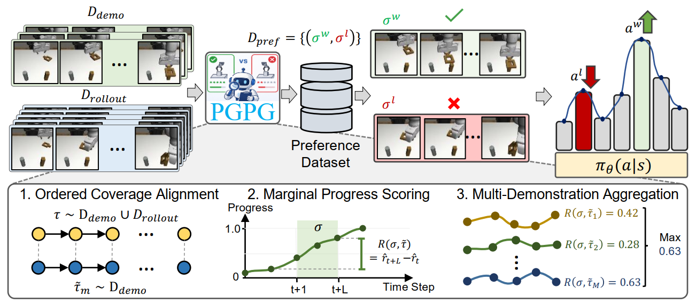

<div><h2>[CoRL'26] Progress-Guided Preference Generation for Aligning Generative Control Policies</h2></div>
<br>

**[Tung M. Luu](https://tungluu94.github.io/)<sup>1</sup>, [Tri Ton](https://triton99.github.io)<sup>1</sup>, [Duc M. Nguyen](https://openreview.net/profile?id=~Minh_Duc_Nguyen3)<sup>2,3</sup>, [Xuan Thanh Nguyen](https://thanhkaist.github.io/)<sup>1</sup>, [Nguyen Gia Binh](https://openreview.net/profile?id=~Nguyen_Gia_Binh1)<sup>2,3</sup>, [Quang Tan Nguyen](https://openreview.net/profile?id=~Quang_Tan_Nguyen1)<sup>3</sup>, [Vu Duong](https://scholar.google.com/citations?user=ilaMdTEAAAAJ&hl=en)<sup>2</sup>, [Daniel Sonntag](https://www.dfki.de/~daso02/)<sup>6,7</sup>, [Duy M. H. Nguyen](https://duyhominhnguyen.github.io/)<sup>4,5,6</sup>, [Vien Anh Ngo](https://vienngo.github.io/)<sup>2,3</sup>, [Chang D. Yoo](https://sanctusfactory.com/family.php)<sup>1</sup>**
<br>
<sup>1</sup>KAIST &nbsp; <sup>2</sup>Center for AI Research & CECS, VinUniversity &nbsp; <sup>3</sup>VinRobotics &nbsp; <sup>4</sup>University of Stuttgart<br><sup>5</sup>Max Planck Research School for Intelligent Systems &nbsp; <sup>6</sup>DFKI &nbsp; <sup>7</sup>University of Oldenburg
<br>

<p align="center">
        <a href="https://pgpg2026.github.io/" target='_blank'>
        
        </a>
        <a href="https://openreview.net/pdf?id=J8pJIDI6rM" target='_blank'>
        
        </a>
        <a href="https://arxiv.org/abs/2610.25692" target='_blank'>
        
        </a>
</p>

<p align="center">
    
</p>

## Overview
This is the official implementation of **Progress-Guided Preference Generation (PGPG)**.

**TL;DR**: PGPG aligns a pretrained generative control policy without any human preference labels. It scores autonomously collected rollouts against a handful of expert demonstrations using ordered coverage alignment (ORCA), converts that cumulative progress into per-step marginal rewards, and turns the result into pseudo-preference pairs for contrastive preference learning.

## ⚙️ Environmental Setups

```sh
git clone https://github.com/tunglm2203/pgpg.git
cd pgpg

# install pgpg environment
conda create --name py39_dp python=3.9
conda activate py39_dp
pip install -r requirements.txt --no-deps --extra-index-url https://download.pytorch.org/whl/cu128
pip install -e .
```

## 📁 Data Preparations
PGPG needs expert demonstrations, policy rollouts (both with rendered videos for visual progress scoring), and the pretrained reference policies. The demonstrations are the [robomimic](https://robomimic.github.io/) MH/PH datasets, replayed in simulation to add dense rewards and per-step success flags.

**Option 1 — download the preprocessed data (recommended):**
```
bash bash_script/others/download_data.sh
```

**Option 2 — replay the demonstrations yourself:**
```
# download the original robomimic datasets first
bash bash_script/others/download_dataset.sh

# replay them to add dense rewards, success flags, and videos
bash bash_script/data_collect/run_collectdata_dp_transformer.sh
```

## 🚀 Get Started
```
# check if environment is activated properly
conda activate py39_dp

# PGPG on a diffusion policy. TASK = lift | can | square | transport | tool_hang
GPU=0 TASK=square bash bash_script/training/train_pgpg_dp_transformer.sh

# PGPG on a rectified-flow policy
GPU=0 TASK=square bash bash_script/training/train_pgpg_reflow_transformer.sh

# omit TASK to run all five tasks in turn
GPU=0 bash bash_script/training/train_pgpg_dp_transformer.sh
```

## ⭐ Citation
If you find our repository useful, please consider giving it a star ⭐ and citing our research papers in your work:
```
@inproceedings{luu2026pgpg,
  title={Progress-Guided Preference Generation for Aligning Generative Control Policies},
  author={Luu, Tung M. and Ton, Tri and Nguyen, Duc M. and Nguyen, Xuan Thanh and Nguyen, Gia Binh and Nguyen, Quang Tan and Duong, Vu and Sonntag, Daniel and Nguyen, Duy M. H. and Ngo, Vien Anh and Yoo, Chang D.},
  booktitle={Conference on Robot Learning (CoRL)},
  year={2026}
}
```

## Acknowledgements
- This repo contains code adapted from [Diffusion Policy](https://github.com/real-stanford/diffusion_policy) and [CPL](https://github.com/jhejna/cpl). We thank the authors and contributors for open-sourcing their code.

## License

MIT
